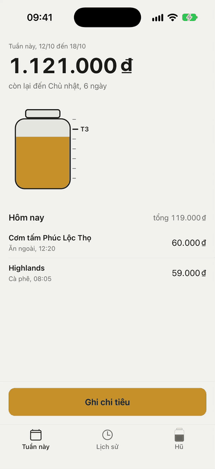

# Example: Hũ (weekly budget jars)

The output of one full run of `taste-mobile-app-skill` 0.3 in `--autonomous` mode on an empty repo, brief "a personal weekly budget app for young office workers in Saigon: set an amount for the week, log each spend in a few seconds at the counter, one-handed", stack Expo, posture unified-brand (iOS and Android both first-class). Everything here was produced by the skill's phases in order; the design file was complete before the first screen was written. The device pass ran on an iPhone 17 Pro simulator after the build: three defects fixed, the Phase 8 clip recorded, screenshots in `screens/`.

## What is here

| Path | Phase | Content |
|---|---|---|
| `app/MOBILE-DESIGN.md` | 1 to 5, 7 | The locked direction **Hũ thủy tinh** (glass jar of coins × kitchen table): schema 3 front matter with the Assumptions block of autonomous mode, three reference extractions (Apple Wallet, Copilot Money, Monzo), visual DNA, composition system, motion system, Nav Read, a six-screen inventory with a Motion field per screen, flow decisions, the Visual QA contract, the demo beat sheet marked pending, and a change log |
| `app/` | 6 | Expo SDK 57 + Expo Router 57 source: tokens, an in-memory budget store seeded with three weeks of spends, components and the six inventory screens |

No brief gate round was held (`--autonomous`): the App Read lists what was inferred (four jars, Monday-to-Sunday weeks, VND without decimals, no account, local data). Three direction cards were written (Phong bì giấy as the category standard, Hũ thủy tinh, Bảng đen quán); Hũ thủy tinh was chosen because the jar carries the identity in space and gives the signature motion a physical home, and because a light surface serves a counter at noon.

## What the build covers

All six screens in the inventory:

- `Tuần này` (tab root, Hero): the remaining amount at display size with "còn lại đến Chủ nhật", the drawn jar with the week's tick marks and today's tick, today's spends as rows, one filled button in a footer above the tab bar.
- `Ghi chi tiêu` (page sheet, Focused Task): the amount typed on the number pad already open, a 000 key and Xong on the iOS accessory bar (a 000 chip on Android), four jar chips, the consequence line "Hũ cà phê: 196.000 → 141.000 ₫, còn 6 ngày", recent places for the chosen jar as chips, an optional note, Lưu in a keyboard-sticky footer. The dirty sheet confirms discard.
- `Lịch sử` (tab root, List): spends grouped by week with the weekly total in the header, a muted day caption inside each week, amounts as a tabular column.
- `Chi tiết chi tiêu` (push, Focused Task): the amount editable in place, the jar as chips, the consequence after the edit, the note, the time row, Lưu thay đổi, and Xóa behind an alert with Giữ lại, then Hoàn tác in the snackbar.
- `Hũ` (tab root, Dashboard): one figure, the week against last week through the same weekday ("ít hơn tuần trước"), then the four jars as rows with a small jar glyph carrying each level, name, remaining and spent; one total line. No chart, no cards.
- `Đặt hạn mức` (form sheet, Focused Task): four steppers in 50.000 ₫ steps, "Tổng tuần: 1.500.000 ₫" as the live consequence, Lưu hạn mức.

Shared primitives: the jar (`components/Jar.tsx`, `react-native-svg`, the coin level as one accent rect clipped to the glass body, animated with Reanimated on the UI thread), the rolling numeral, the amount field with its keypad accessory, pill chips, the filled button with settle-character press feedback, the spend row, a snackbar with Undo. Data lives in `data/` (`budget.ts` store, `seed.ts` three weeks of Saigon spends built relative to the device's current week, `format.ts` VND and week helpers); there is no backend, so every spend is real inside the session and gone on restart. The load-failed state exists as a code path but is unreachable with the seed.

## Motion system

Character `settle`. The signature motion is the coin level in the jar on Tuần này settling to the new amount in 300 ms, decelerating, with the remaining numeral rolling in 200 ms, after a spend is saved, undone, edited or deleted; the list, the tick marks, the button and the chrome do not move. Enter is platform only on every screen. Change happens in place: consequence lines swap their figures, stepper numerals roll, a deleted row fades while its siblings close the gap, the small jar levels on Hũ settle. The success moment is one event, Lưu on Ghi chi tiêu: haptic, platform dismiss, then the settle on Tuần này and a snackbar with Hoàn tác. The commit is deferred by the dismiss duration (350 ms) so the settle is seen after the sheet lands rather than behind it; the modal never touches state after it unmounts. Nothing enters, loops, bounces or springs; press feedback is timing in and timing out.

## Demo clip

The beat sheet in `app/MOBILE-DESIGN.md` §Demo: Tuần này at its first viewport, then Ghi chi tiêu → 55, 000 → Cà phê → Phúc Long → Lưu, ending on Tuần này with the level settled from 75% to 71% and the numeral at 1.066.000 ₫. The figures hold on a Tuesday (the seed is relative to the device date). Recorded on an iPhone 17 Pro simulator with `xcrun simctl io recordVideo` (`references/demo-video.md`); pauses between taps were trimmed and the motion plays at its real speed. The device pass found three defects, recorded in the design file's change log: a clipped amount, an empty limits sheet, and the keypad bar falling back to the system Done.



## What Phase 7 found and fixed (from code)

Mechanical pass: TypeScript clean after two type fixes (the tabular style token and the jar's color props), both grep blocks clean (five font sizes, no inline hex outside `theme/tokens.ts`, no magic insets, no em dashes, no emoji, no `@react-navigation` imports, three `Alert.alert` calls all confirming discard or delete with Cancel, bounded `.map` over the four jars only), layout-mechanics checklist with file:line evidence in the design file's change log.

Visual pass from code, fixed in one round: chip labels changed weight when selected and would have shifted neighbors under the thumb; the limits stepper numeral could widen past its minimum width and move the − button; the sheet title at heading size competed with the first stepper for the anchor; and a real bug, `router.back()` in the same tick as `setSaving(true)` would have let `usePreventRemove` fire the discard alert on every save, replaced by a close effect that runs after the commit.

Not verified without a device: the page sheet's top inset on iOS, the form sheet detent on Android, the keyboard-sticky footer with the accessory bar, the deferred commit timing against the real dismiss, the SVG `animatedProps` on the jar, the FlatList layout animation on delete, dark mode, and Dynamic Type.

## Run it

```bash
cd app
npm install --legacy-peer-deps
npx expo start
```

Open in Expo Go on a device or simulator. If Metro reports a missing `babel-preset-expo`, add it as a devDependency; see `references/stack-expo.md` §2.
